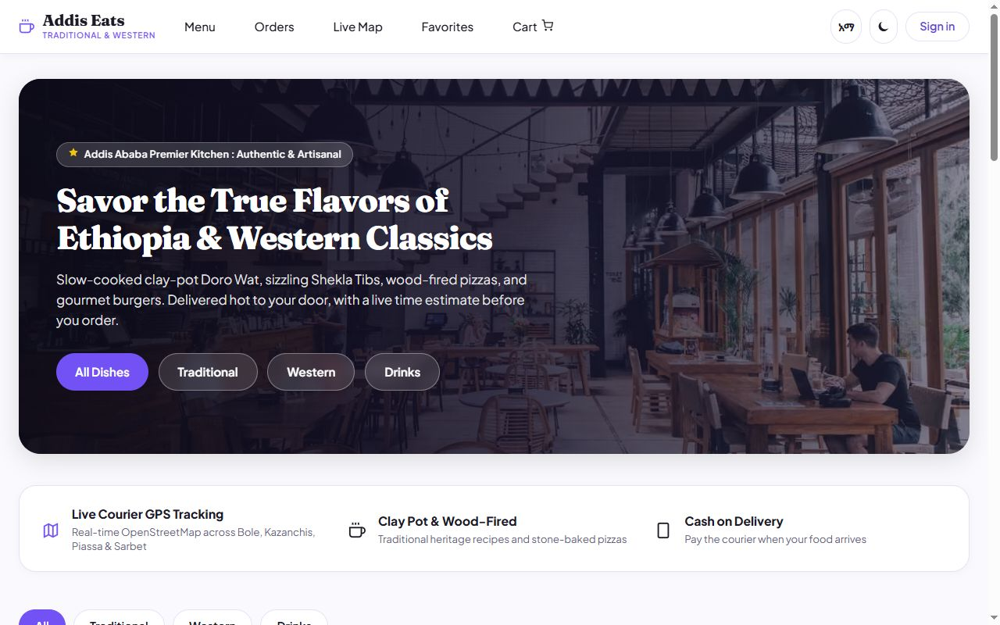
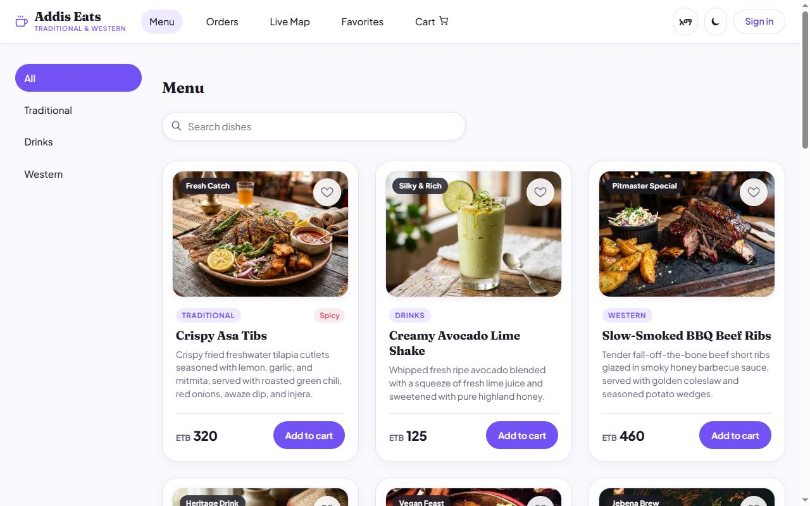

# Addis Eats: Food Ordering and Delivery

Addis Eats is a full-stack food ordering system for a restaurant in Addis Ababa. Customers order and pay online or in cash and follow their delivery on a live map. The kitchen and couriers each have their own board, and the admin runs the menu, staff, hours and finances. It started as the capstone of the **IBT-QIYAS Full-Stack Software Development Program** and grew over four versions, from a React menu to this Next.js app with a shared database, payments and push notifications.

**Live site:** https://addis-eats-project-taupe.vercel.app

<p>
  
  
</p>

---

## Quick start

```bash
npm install
cp .env.example .env.local   # then fill it in (see "Settings" below)
npm run dev                  # http://localhost:3000
npm run lint
npm run build && npm run start
```

Without any settings the app still runs: data is kept in `.addis-data/` JSON files, customers use local accounts, and payment is cash on delivery.

---

## Who uses Addis Eats

| Account | How it is created | Signs in at | Area |
|---|---|---|---|
| **Customer** | Registers at `/signin`, or with Google | `/signin` | Menu, cart, checkout, orders, live tracking, favourites, profile |
| **Kitchen staff** | Registered by the admin at `/admin/staff` | `/staff/signin` | `/kitchen`: order board and history |
| **Kitchen tablet** | A shared tablet set up by the admin | `/kitchen/tablet` | The kitchen board; each cook claims orders with their PIN |
| **Courier** | Registered by the admin (name, phone and photo) | `/staff/signin` | `/delivery`: delivery pool, map and history |
| **Admin** | From `ADDIS_ADMIN_EMAIL` / `ADDIS_ADMIN_PASSWORD` on first start | `/staff/signin` | `/admin`: menu, orders, staff, team, finances, settings |

There is no public staff sign-up. The server decides each person's role from their account, never from the browser. See [AUTH.md](./AUTH.md) for the full model.

---

## Features

### Customers
- Menu with search-as-you-type, categories and dish pages; cart and favourites.
- Checkout with a delivery fee per neighbourhood, an optional map pin, and driving-time estimates. When a field is missing, the page jumps to it.
- **Pay online with Chapa** (telebirr, CBE Birr, cards) or in cash on delivery. Chapa opens in a pop-up window, and the order page continues by itself once payment is confirmed.
- Live order status, the courier's name, phone and photo, and the courier's location on a map when they share it.
- **Push notifications** for each stage: confirmed, cooking, on the way, delivered. The app asks once when an order is placed; switch them off in Profile → Notifications.
- Cancel within the first 5 minutes, confirm delivery with a code, rate the food and the courier, and report a problem.
- English and Amharic, and an option to delete the account.

### Kitchen and couriers
- Kitchen board with new, cooking and ready columns, and alerts when an order arrives.
- Shared kitchen tablet: cooks claim orders with a 4- to 6-digit PIN, so each cook gets credit for their orders.
- Courier board: take orders from the live pool, see the customer's pin and directions, share location, and finish with the customer's delivery code.

### Admin
- **Taking orders:** pause new orders with a message, or set opening hours.
- Menu management: add or edit dishes, photos, prices, availability.
- Every order, with editing, CSV export and problem reports.
- Staff accounts: register cooks and couriers, reset passwords, remove staff.
- Team page: each person's orders, ratings and activity by day, week or month.
- Finances: income from orders against daily ingredient and transport costs.
- Favourite dishes by neighbourhood.

### Site
- Privacy policy (`/privacy`) and terms of use (`/terms`).
- Installable as an app on phones (web app manifest), with security headers that stop other sites from embedding it in a frame.

---

## How it works

1. **One shared database.** With Supabase set up, every record (orders, dishes, accounts, costs) lives in the table `addis_records` (see `supabase/setup.sql`), so every server instance on Vercel sees the same data. Without it, data lives in `.addis-data/` files. Each request loads the latest data first and saves its changes before it finishes.
2. **Every change is checked on the server.** Server actions (`app/actions.js`) and API routes check the signed-in role before doing anything. Order data is filtered by role: a customer sees only their own orders, and a courier only the ones they deliver.
3. **Sign-in.** Staff and local accounts use scrypt-hashed passwords and a signed, httpOnly session cookie. Changing a password signs out every other device, and repeated wrong passwords lock sign-in for a while. Customers can also use Supabase Auth with Google.
4. **Payments are verified with Chapa.** An order counts as paid only after the server checks it with Chapa's verify API using the secret key. Signed webhooks are checked too. Nothing the browser says is trusted.
5. **Delivery estimates** use Google's Routes API with live traffic when a key is set. Otherwise they use the public OSRM road router, or the neighbourhood's time range when there is no map pin.

---

## Settings

Put these in `.env.local` locally, and under **Vercel → Settings → Environment Variables** for the live site:

| Variable | What it is |
|---|---|
| `NEXT_PUBLIC_SUPABASE_URL`, `NEXT_PUBLIC_SUPABASE_PUBLISHABLE_KEY` | Supabase project address and publishable key (customer accounts, Google sign-in) |
| `SUPABASE_SECRET_KEY` | Supabase secret key (`sb_secret_…`): lets every server share one database. Never prefix it with `NEXT_PUBLIC_`. |
| `ADDIS_SESSION_SECRET` | Long random text that signs session cookies |
| `ADDIS_ADMIN_EMAIL`, `ADDIS_ADMIN_PASSWORD` | The first admin account |
| `CHAPA_SECRET_KEY` | Chapa private key. Without it, payment is cash on delivery. |
| `VAPID_PUBLIC_KEY`, `VAPID_PRIVATE_KEY`, `VAPID_SUBJECT` | Push notification keys: `npx web-push generate-vapid-keys` |
| `ADDIS_RESTAURANT_LAT`, `ADDIS_RESTAURANT_LNG` | Restaurant location for driving times (defaults to Bole Road) |
| `GOOGLE_MAPS_API_KEY` | Optional: live-traffic estimates (Routes API, billed by Google) |
| `NEXT_PUBLIC_SITE_URL` | The site's address, for metadata, the sitemap and payment return links |
| `ADDIS_DATA_DIR` | Optional folder for the local JSON files |

**Supabase setup, once:** run `supabase/setup.sql` in **SQL Editor**, or run `npm run setup:supabase`. Google sign-in and redirect URLs are described in [SUPABASE.md](./SUPABASE.md).

---

## More documentation

- [AUTH.md](./AUTH.md): accounts, sessions, roles and the kitchen tablet
- [SUPABASE.md](./SUPABASE.md): Supabase and Google sign-in setup
- [DATA.md](./DATA.md): how data is loaded and refreshed
- [PERF.md](./PERF.md): performance budget and Core Web Vitals
- [SEO.md](./SEO.md): metadata, share images, sitemap and robots
- [BOUNDARY.md](./BOUNDARY.md): server and client components
- [FUTURE.md](./FUTURE.md): what's planned next

---

## Testing

The checkout, payment, notification and role flows were checked with automated Playwright end-to-end runs during development. Those runs use file storage, a stand-in for the Supabase database and a stand-in for Chapa. The test scripts are not in this repository yet.

---

## License & attribution

Created for the **IBT-QIYAS Full-Stack Software Development Program**.
All rights reserved © 2026 Addis Eats.
